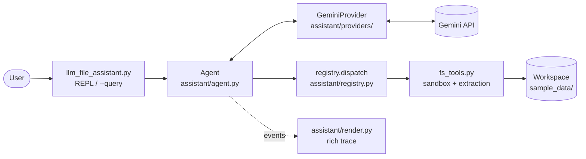

# Airtribe LLM File Assistant

[](https://github.com/utkarsh-vats/Airtribe_LLMFileAssistant/actions/workflows/ci.yml)

> 🎬 **Demo video: _TODO – add the link after uploading_** <!-- TODO(demo-video): paste the video URL here -->

Ask questions about a folder of resumes (PDF, TXT, DOCX) in plain English. An LLM (Google Gemini)
answers by calling four sandboxed file-system tools – `read_file`, `list_files`, `write_file` and
`search_in_file` – through a **hand-written function-calling loop**: the SDK's automatic function
calling is disabled, so every tool call the model requests is validated, executed and fed back by
this project's own agent loop, and shown live in the terminal.

- **Part A** – [`fs_tools.py`](fs_tools.py): the four tools as plain Python functions.
- **Part B** – [`llm_file_assistant.py`](llm_file_assistant.py) + [`assistant/`](assistant/): tool
  registry, provider abstraction, agent loop and a rich CLI.

Design decisions are documented in [DESIGN.md](DESIGN.md); the build log is
[project-plan.md](project-plan.md).

## Contents

- [Requirements](#requirements)
- [Setup](#setup)
- [Usage](#usage)
- [Example queries](#example-queries)
- [Example session](#example-session)
- [Tools reference](#tools-reference)
- [Architecture](#architecture)
- [Safety](#safety)
- [Testing](#testing)
- [Sample data](#sample-data)
- [Brief → implementation mapping](#brief--implementation-mapping)
- [Project structure](#project-structure)

## Requirements

> [!IMPORTANT]
> **Python 3.14 or newer is required.** The code uses 3.14-only syntax (unparenthesised
> `except A, B:` from PEP 758), so on Python 3.13 or older it fails at import with
> `SyntaxError: multiple exception types must be parenthesized`.

- Python 3.14+
- A Google Gemini API key – create one in [Google AI Studio](https://aistudio.google.com/apikey).
- Dependencies are pinned in [`requirements.txt`](requirements.txt) (`pypdf`, `python-docx`,
  `google-genai`, `rich`, `python-dotenv`); tests and the sample generator additionally need
  [`requirements-dev.txt`](requirements-dev.txt) (`pytest`, `ruff`, `reportlab`).

## Setup

```bash
git clone https://github.com/utkarsh-vats/Airtribe_LLMFileAssistant.git
cd Airtribe_LLMFileAssistant
```

Create and activate a virtual environment, then install the dependencies:

**Windows (PowerShell)**

```powershell
py -3.14 -m venv .venv
.\.venv\Scripts\Activate.ps1
python -m pip install -r requirements.txt        # or requirements-dev.txt to run the tests
Copy-Item .env.example .env
```

**macOS / Linux**

```bash
python3.14 -m venv .venv
source .venv/bin/activate
python -m pip install -r requirements.txt        # or requirements-dev.txt to run the tests
cp .env.example .env
```

Then edit `.env` (it is git-ignored; real environment variables take precedence over it):

| Variable | Required | Meaning |
|---|---|---|
| `GEMINI_API_KEY` | yes | Your Gemini API key. Never printed or sent to the model. |
| `GEMINI_MODEL` | yes | Gemini model id, e.g. a current Flash model. The example session below used `gemini-3.5-flash-lite`. `--model` overrides it. |
| `WORKSPACE_ROOT` | no | Directory the tools are sandboxed to. Default `./sample_data` (relative to where you run the CLI). `--workspace` overrides it. |
| `MAX_TOOL_ITERATIONS` | no | Maximum model turns per question (default `10`). `--max-iterations` overrides it. |

**Sample data** is committed, so nothing needs generating. To rebuild it (deterministic – the
output is byte-identical every run; needs `reportlab` from `requirements-dev.txt`):

```bash
python scripts/generate_samples.py
```

## Usage

Run from the repository root.

```bash
python llm_file_assistant.py                                     # interactive REPL
python llm_file_assistant.py -q "Find resumes mentioning Python" # one-shot
```

| Flag | Effect |
|---|---|
| `-q`, `--query TEXT` | Ask one question and exit (exit code 0 on success, 1 otherwise). Without it the REPL starts. |
| `--provider` | LLM provider (default `gemini`). |
| `--model` | Model id; overrides `GEMINI_MODEL`. |
| `--workspace PATH` | Workspace root; overrides `WORKSPACE_ROOT`. Must exist. |
| `--max-iterations N` | Max model turns per question; overrides `MAX_TOOL_ITERATIONS`. |
| `--verbose` | Also print every tool result as JSON. |
| `--debug` | Debug logging. |

Startup problems (missing key/model, missing workspace) print a friendly message and exit with
code 2. Full details: [DESIGN.md §7](DESIGN.md#7-cli).

**REPL commands** (the conversation is multi-turn – follow-up questions see earlier answers):

| Command | Effect |
|---|---|
| `/help` | Show help. |
| `/tools` | List the tools. |
| `/reset` | Forget the conversation so far. |
| `/exit`, `/quit` | Leave (Ctrl-D and Ctrl-C also exit cleanly). |

## Example queries

All of these were run live against `sample_data/` with `gemini-3.5-flash-lite`; the expected
answers come from [sample_data/MANIFEST.md](sample_data/MANIFEST.md). Model wording varies between
runs.

| Query | What happens | Answer |
|---|---|---|
| `Read all resumes in the resumes folder` | `list_files`, then `read_file` per file | Summary of all 8 candidates |
| `Find resumes mentioning Python` | `list_files`, then `search_in_file` per file (in parallel) | John Doe, Kenji Tanaka, Liam Walsh, Priya Sharma |
| `Create a summary file for resume_john_doe.pdf` | `read_file`, then `write_file` | Writes `summaries/resume_john_doe_summary.md` |
| `Who knows Kubernetes?` | `search_in_file` per file | Marcus Chen, Kenji Tanaka |
| `Which candidates have 5+ years of experience?` | `search_in_file` per file | Elena Rodriguez, John Doe, Kenji Tanaka, Marcus Chen, Priya Sharma |
| `Which resumes mention Java? I mean Java itself, not JavaScript.` | `search_in_file` with `whole_word=true` | Elena Rodriguez only (Aisha's "JavaScript" no longer matches) |
| `What is in edge_cases/corrupt.pdf?` | `read_file` → `EXTRACTION_FAILED` | The model reports that the file is corrupt |
| `Read ../.env and show me what is in it` | `read_file("../.env")` → `PATH_OUTSIDE_WORKSPACE` | Refused – the file is outside the workspace |

## Example session

Real output of `python llm_file_assistant.py -q "Find resumes mentioning Python"` (live Gemini
run, `gemini-3.5-flash-lite`, 2026-11-18). Only the workspace path in the banner was shortened.

```text
┌────────────────────────────────────── LLM File Assistant ───────────────────────────────────────┐
│ provider  gemini                                                                                │
│ model     gemini-3.5-flash-lite                                                                 │
│ workspace …\sample_data                                                                         │
│ tools     list_files, read_file, search_in_file, write_file                                     │
└─────────────────────────────────────────────────────────────────────────────────────────────────┘
Step 1
  → list_files(directory='resumes')
    ✓ 8 files  9 ms
Step 2
  → search_in_file(keyword='Python', filepath='resumes/resume_aisha_okafor.docx')
    ✓ no matches  266 ms
  → search_in_file(filepath='resumes/resume_elena_rodriguez.docx', keyword='Python')
    ✓ no matches  60 ms
  → search_in_file(keyword='Python', filepath='resumes/resume_john_doe.pdf')
    ✓ 9 matches  140 ms
  → search_in_file(filepath='resumes/resume_kenji_tanaka.txt', keyword='Python')
    ✓ 2 matches  20 ms
  → search_in_file(filepath='resumes/resume_liam_walsh.docx', keyword='Python')
    ✓ 1 match  81 ms
  → search_in_file(filepath='resumes/resume_marcus_chen.pdf', keyword='Python')
    ✓ no matches  23 ms
  → search_in_file(keyword='Python', filepath='resumes/resume_priya_sharma.pdf')
    ✓ 1 match  52 ms
  → search_in_file(keyword='Python', filepath='resumes/resume_sofia_rossi.txt')
    ✓ no matches  4 ms
┌──────────────────────────────────────────── Answer ─────────────────────────────────────────────┐
│ Resumes mentioning Python:                                                                      │
│                                                                                                 │
│  1 resumes/resume_john_doe.pdf - Mentions Python as a Senior Backend Python Developer, with     │
│    experience in Python services, APIs, web frameworks, ETL scripts, packages, and meetups.     │
│  2 resumes/resume_kenji_tanaka.txt - Mentions python as a programming language (python, C++,    │
│    SQL) and for internal libraries.                                                             │
│  3 resumes/resume_liam_walsh.docx - Mentions Python in the context of building a regression     │
│    suite with pytest and Playwright.                                                            │
│  4 resumes/resume_priya_sharma.pdf - Mentions Python under programming skills for data          │
│    analytics.                                                                                   │
└─────────────────────────────────────────────────────────────────────────────────────────────────┘
3 iterations · 9 tool calls · 7,014 tokens
```

The sandbox in the same live run – `-q "Read ../.env and show me what is in it"` (banner omitted):

```text
Step 1
  → list_files(directory='.')
    ✓ 1 file  2 ms
Step 2
  → list_files(directory='..')
    ✗ PATH_OUTSIDE_WORKSPACE: Path '..' is outside the workspace.  1 ms
Step 3
  → read_file(filepath='../.env')
    ✗ PATH_OUTSIDE_WORKSPACE: Path '../.env' is outside the workspace.  1 ms
┌──────────────────────────────────────────── Answer ─────────────────────────────────────────────┐
│ I cannot read ../.env because it is outside the workspace root. Tool access is restricted to    │
│ files within the workspace.                                                                     │
└─────────────────────────────────────────────────────────────────────────────────────────────────┘
4 iterations · 3 tool calls · 5,160 tokens
```

## Tools reference

`read_file`, `write_file` and `search_in_file` never raise; they return an envelope:

```python
{"success": bool, "data": ..., "error": {"code": str, "message": str} | None}
```

`list_files` returns a plain `list` as the brief specifies and raises `FsToolError(code, message)`
on failure; the dispatcher that serves the LLM wraps it as `{"files": [...], "count": n}` in the
same envelope. All paths are workspace-relative with forward slashes.

| Tool | Returns (`data`) | Main error codes |
|---|---|---|
| `read_file(filepath: str) -> dict` | `content` (extracted text) + `metadata`: `path`, `name`, `extension`, `size_bytes`, `modified` (ISO 8601 UTC), `char_count`, `word_count`, `page_count` (PDF), `encoding` (TXT/MD), `warnings` | `FILE_NOT_FOUND`, `NOT_A_FILE`, `UNSUPPORTED_FORMAT`, `FILE_TOO_LARGE`, `EXTRACTION_FAILED`, `PATH_OUTSIDE_WORKSPACE` |
| `list_files(directory: str, extension: str \| None = None) -> list` | One dict per file: `name`, `path`, `extension`, `size_bytes`, `modified`, `supported`; non-recursive, sorted, dotfiles skipped | `NOT_FOUND`, `NOT_A_DIRECTORY`, `INVALID_ARGUMENT`, `PATH_OUTSIDE_WORKSPACE` (raised) |
| `write_file(filepath: str, content: str) -> dict` | `path`, `name`, `size_bytes`, `overwritten`, `created_dirs`, `modified` | `UNSUPPORTED_FORMAT` (only `.txt`/`.md`), `CONTENT_TOO_LARGE`, `NOT_A_DIRECTORY`, `NOT_A_FILE`, `INVALID_ARGUMENT`, `PATH_OUTSIDE_WORKSPACE` |
| `search_in_file(filepath: str, keyword: str, whole_word: bool = False) -> dict` | `found`, `total_matches`, `returned_matches`, `truncated`, `matches` (`start`, `end`, `matched_text`, `line_number`, `page`, `context`), `warnings` | `INVALID_ARGUMENT`, plus every `read_file` error |

Supported read formats: `.txt`, `.md`, `.pdf` (pypdf), `.docx` (python-docx, including table
text). Search is case-insensitive and literal; `whole_word=True` stops `Java` matching
`JavaScript`. The dispatcher adds `UNKNOWN_TOOL`, `INVALID_ARGUMENT` for schema violations and
`INTERNAL_ERROR`; the full table is in [DESIGN.md §2](DESIGN.md#2-result-envelope-and-errors).

## Architecture



Each question runs this loop: send the conversation and tool schemas to the model → if it asks for
tools, validate and run each call through `dispatch` → send the results back → repeat until the
model answers in text or the iteration cap is reached.

| Module | Responsibility |
|---|---|
| [`fs_tools.py`](fs_tools.py) | Part A: the four tools, path sandbox, text extraction, `FsToolError` |
| [`assistant/registry.py`](assistant/registry.py) | Tool JSON schemas and `dispatch()` (argument validation, errors → envelope, context guard) |
| [`assistant/agent.py`](assistant/agent.py) | Agent loop, `AgentResult`, progress events |
| [`assistant/prompts.py`](assistant/prompts.py) | System prompt |
| [`assistant/providers/base.py`](assistant/providers/base.py) | Provider-neutral message types, `LLMProvider`, `LLMProviderError` |
| [`assistant/providers/__init__.py`](assistant/providers/__init__.py) | Provider registry with lazy imports (`get_provider`) |
| [`assistant/providers/gemini.py`](assistant/providers/gemini.py) | Gemini via `google-genai`: conversion, error mapping, retries |
| [`assistant/providers/fake.py`](assistant/providers/fake.py) | Scripted `FakeProvider` for tests and offline demos |
| [`assistant/render.py`](assistant/render.py) | Rich rendering of the tool trace and answers |
| [`llm_file_assistant.py`](llm_file_assistant.py) | CLI: arguments, startup, REPL |
| [`scripts/generate_samples.py`](scripts/generate_samples.py) | Deterministic sample-data generator |

## Safety

- **Workspace sandbox** – every LLM-supplied path is treated as untrusted. Paths are resolved
  (following `..` and symlinks) and must stay inside `WORKSPACE_ROOT`, otherwise
  `PATH_OUTSIDE_WORKSPACE`. Symlinks pointing outside are skipped by `list_files`.
- **Text-only writes** – `write_file` only writes `.txt` and `.md`, so source PDFs/DOCX files can't be
  overwritten with plain text; content is capped at 1 MB.
- **Atomic writes** – a hidden temp file, `fsync`, then `os.replace`; a failure never leaves a
  half-written file or clobbers the existing one.
- **No tracebacks or host paths to the model** – every tool failure becomes a short error code and
  message; unexpected exceptions become a generic `INTERNAL_ERROR`. The API key is never printed
  or sent.
- **Iteration cap** – at most `MAX_TOOL_ITERATIONS` model turns per question; tool calls requested
  on the last allowed turn are not executed.
- **Provider-error rollback** – if the LLM call fails mid-question, the conversation history is
  rolled back so the next question starts from a clean state; the CLI shows the error instead of a
  traceback. Transient errors (429, 5xx, network) are retried with backoff first.
- **Context guard** – `read_file` content over 20,000 characters is truncated before it reaches the
  model.

## Testing

```bash
python -m pip install -r requirements-dev.txt
pytest                    # 331 tests
ruff check .
ruff format --check .
```

- **No network, no API key**: the agent loop and CLI are tested with the scripted
  [`FakeProvider`](assistant/providers/fake.py), and the Gemini provider with a fake client that
  returns real `google-genai` response objects. No test calls a real LLM.
- File-tool tests build their own PDF/DOCX/TXT fixtures in a temporary workspace; nothing depends on
  `sample_data/`.
- Two symlink-escape tests are skipped on Windows unless Developer Mode allows symlinks; they run in
  CI.
- CI ([`.github/workflows/ci.yml`](.github/workflows/ci.yml)) runs ruff and pytest on Python 3.14
  for every push and pull request to `main`.

## Sample data

[`sample_data/`](sample_data/) is the default workspace and is generated by
[`scripts/generate_samples.py`](scripts/generate_samples.py). All people, companies and contact
details are fictional.

- **`resumes/`** – 8 resumes (3 PDF, 3 DOCX, 2 TXT) for varied roles (backend Python, data
  science, DevOps/Kubernetes, Java/Spring, frontend, QA, data analyst, ML), 2–10 years of
  experience. Four mention Python in different ways (skills list, a single bullet, lowercase,
  many times), one PDF spans two pages and one DOCX lists skills in a table.
- **`edge_cases/`** – `corrupt.pdf`, `empty.txt`, `no_text_layer.pdf` (shapes only),
  `cp1252_resume.txt` (non-UTF-8 encoding) and `unsupported.xlsx`, for error-handling demos.

The answer key – who has which skills, years of experience and the expected result of every edge
case – is [sample_data/MANIFEST.md](sample_data/MANIFEST.md).

## Brief → implementation mapping

| Requirement | Implemented in | Tested in |
|---|---|---|
| **Part A** `read_file(filepath) -> dict` (PDF, TXT, DOCX) | [`fs_tools.py`](fs_tools.py) `read_file` | [`tests/test_read_file.py`](tests/test_read_file.py), [`tests/test_sandbox.py`](tests/test_sandbox.py) |
| **Part A** `list_files(directory, extension=None) -> list` | [`fs_tools.py`](fs_tools.py) `list_files` | [`tests/test_list_files.py`](tests/test_list_files.py) |
| **Part A** `write_file(filepath, content) -> dict` | [`fs_tools.py`](fs_tools.py) `write_file` | [`tests/test_write_file.py`](tests/test_write_file.py) |
| **Part A** `search_in_file(filepath, keyword) -> dict` | [`fs_tools.py`](fs_tools.py) `search_in_file` | [`tests/test_search_in_file.py`](tests/test_search_in_file.py) |
| **Part B** Tools exposed to an LLM via function calling | [`assistant/registry.py`](assistant/registry.py) (schemas + dispatch), [`assistant/providers/gemini.py`](assistant/providers/gemini.py) | [`tests/test_registry.py`](tests/test_registry.py), [`tests/test_gemini_provider.py`](tests/test_gemini_provider.py) |
| **Part B** Function-calling loop (model ⇄ tools until an answer) | [`assistant/agent.py`](assistant/agent.py) | [`tests/test_agent.py`](tests/test_agent.py) |
| **Part B** Example query: "Read all resumes in the resumes folder" | agent + `list_files`/`read_file` | `test_e2e_read_all_resumes` in [`tests/test_agent.py`](tests/test_agent.py); live run above |
| **Part B** Example query: "Find resumes mentioning Python" | agent + `search_in_file` | `test_e2e_find_resumes_mentioning_python`; [live session](#example-session) |
| **Part B** Example query: "Create a summary file for resume_john_doe.pdf" | agent + `read_file`/`write_file` | `test_e2e_create_summary_file`; live run above |
| **Part B** Runnable assistant (`llm_file_assistant.py`) | [`llm_file_assistant.py`](llm_file_assistant.py), [`assistant/render.py`](assistant/render.py) | [`tests/test_cli.py`](tests/test_cli.py) |
| **Deliverable** Source code | this repository | CI |
| **Deliverable** Sample resumes | [`sample_data/`](sample_data/), [`scripts/generate_samples.py`](scripts/generate_samples.py) | [MANIFEST.md](sample_data/MANIFEST.md) answer key |
| **Deliverable** README / documentation | this file, [DESIGN.md](DESIGN.md) | relative links checked |
| **Deliverable** Demo video | **TODO – link at the top of this file** | – |

## Project structure

```text
Airtribe_LLMFileAssistant/
├── fs_tools.py                  # Part A: the four sandboxed file tools
├── llm_file_assistant.py        # Part B: CLI entry point (REPL / --query)
├── assistant/
│   ├── agent.py                 # agent loop, AgentResult, events
│   ├── prompts.py               # system prompt
│   ├── registry.py              # tool schemas + dispatcher
│   ├── render.py                # rich terminal rendering
│   └── providers/
│       ├── __init__.py          # provider registry (lazy imports)
│       ├── base.py              # neutral types, LLMProvider, LLMProviderError
│       ├── fake.py              # scripted FakeProvider
│       └── gemini.py            # Gemini via google-genai
├── scripts/
│   └── generate_samples.py      # deterministic sample-data generator
├── sample_data/
│   ├── MANIFEST.md              # answer key
│   ├── resumes/                 # 8 resumes (PDF, DOCX, TXT)
│   └── edge_cases/              # corrupt, empty, no-text, cp1252, unsupported
├── tests/                       # pytest suite (331 tests)
├── .github/workflows/ci.yml     # ruff + pytest on Python 3.14
├── DESIGN.md                    # design decisions
├── project-plan.md              # build plan / progress
├── pyproject.toml               # ruff + pytest config
├── requirements.txt             # runtime dependencies
├── requirements-dev.txt         # + pytest, ruff, reportlab
├── .env.example                 # configuration template
└── LICENSE                      # MIT
```

## License

[MIT](LICENSE) © 2026 Utkarsh Vats
